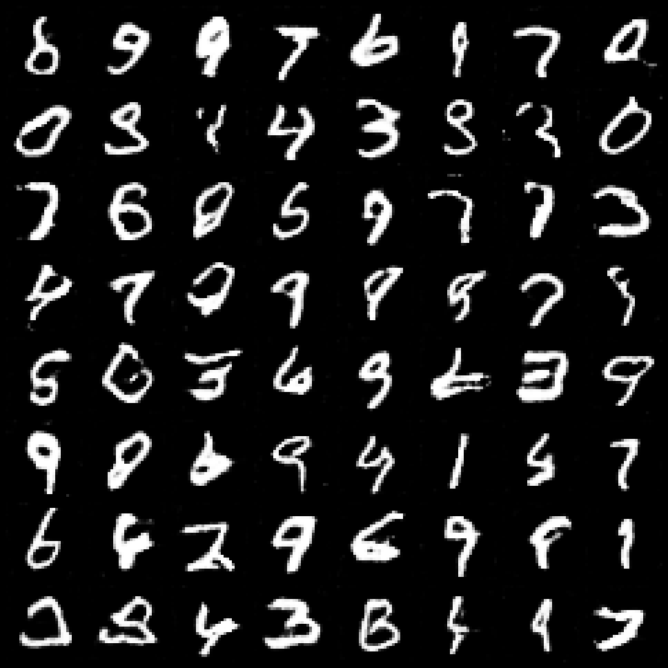

# Assignment 3: Image Generation

Jiajun Shen | js6890

GitHub: [https://github.com/xiangbuchu77/sps-genai-assignment1/tree/codex/assignment3-gan](https://github.com/xiangbuchu77/sps-genai-assignment1/tree/codex/assignment3-gan)

## Part 1. GAN architecture

I implemented the specified unconditional GAN in app/gan.py. The generator has 765,761 parameters; the discriminator has 138,817. Each image is one-channel 28 x 28.

```text
Generator
z: [B,100] -> Linear(100,6272) -> reshape [B,128,7,7]
-> ConvTranspose2d(128,64,4,2,1) -> BatchNorm2d(64) -> ReLU
-> ConvTranspose2d(64,1,4,2,1) -> Tanh -> [B,1,28,28]

Discriminator
[B,1,28,28] -> Conv2d(1,64,4,2,1) -> LeakyReLU(0.2)
-> Conv2d(64,128,4,2,1) -> BatchNorm2d(128) -> LeakyReLU(0.2)
-> Flatten(6272) -> Linear(6272,1)
```

The discriminator returns a logit. Applying sigmoid gives its real/fake probability. BCEWithLogitsLoss combines sigmoid and binary cross-entropy for stable training; no extra sigmoid is applied before this loss.

## Training and generated samples

I trained on all 60,000 official MNIST training images for 30 epochs, with batch size 128 and seed 42, on Apple MPS. Pixels were mapped from [0,255] to [-1,1] to match Tanh. Labels were not used.

Both networks use Adam with learning rate 0.0002 and betas (0.5, 0.999). Each batch has one discriminator update and one non-saturating generator update. D minimizes BCE(real,1) + BCE(fake,0); G minimizes BCE(D(G(z)),1).



Figure 1. All 64 samples from fixed noise seed 1234 after epoch 30; no samples were filtered. Many resemble digits, while some are ambiguous or distorted. This is a visual demonstration, not a measured accuracy or FID result.

## Part 2. Image-generation API

I added POST /generate-image to the existing FastAPI application. It loads models/mnist_gan.pt at startup and runs the generator in evaluation mode on CPU. The original text, embedding and CIFAR-10 classification endpoints remain available.

```text
uv sync --frozen
uv run uvicorn app.main:app --host 127.0.0.1 --port 8000

curl -X POST http://127.0.0.1:8000/generate-image \
  -H "Content-Type: application/json" \
  -d '{"num_samples":16,"seed":42}' --output generated_digits.png
```

The response is a grayscale PNG grid. num_samples accepts integers 1-64, and seed accepts integers 0-4294967295. A request-specific random generator makes the same seed reproducible without resetting global random state. The model is unconditional, so the request does not select a digit class.

The Docker image includes both trained checkpoints. I built and started it without host-mounted model files, then verified the image endpoint and existing endpoints using actual HTTP requests. Invalid generation parameters returned HTTP 422. The PNG response matched direct generator inference in the same container.

Code, weights, training history, example output and run instructions are included in the GitHub branch linked on page 1. Detailed training records are in models/gan_metrics.json and models/gan_training_history.json.

## Part 3. Building blocks of GANs

## Question 1

For dilation 1, the output size in each spatial dimension is O = (I - 1)S - 2P + K + OP.

```text
O = (8 - 1) x 2 - 2 x 1 + 4 + 1
  = 14 - 2 + 4 + 1 = 17
```

The output feature map is 17 x 17.

## Question 2

```text
With stride 3: O = (8 - 1) x 3 - 2 x 1 + 4 + 1 = 24
Increase per dimension = (8 - 1)(3 - 2) = 7
```

The output becomes 24 x 24 instead of 17 x 17. In general, increasing stride by one increases each output dimension by I - 1 when the other parameters stay fixed.

## Question 3

```text
O = (I - 1)S - 2P + K + OP     (dilation = 1)
```

Apply this formula separately to height and width. With dilation d, the general formula is O = (I - 1)S - 2P + d(K - 1) + OP + 1.

## Question 4

One valid choice is kernel size 2 x 2, stride 2, padding 0 and output padding 0.

```text
O = (16 - 1) x 2 - 2 x 0 + 2 + 0 = 30 + 2 = 32
```

Thus the feature map grows from 16 x 16 to 32 x 32.

## Question 5

Use the mini-batch population variance (divide by 4), with no learned scale or shift. The following hand calculation omits the small numerical epsilon.

```text
Mean = (6 + 8 + 10 + 6) / 4 = 7.5

Variance = [(6 - 7.5)^2 + (8 - 7.5)^2
          + (10 - 7.5)^2 + (6 - 7.5)^2] / 4
         = (2.25 + 0.25 + 6.25 + 2.25) / 4 = 2.75

Standard deviation = sqrt(2.75) = 1.658312
Normalized values = (x - 7.5) / 1.658312
                  = [-0.904534, 0.301511, 1.507557, -0.904534]
```

The normalized values have mean 0 and population variance 1. PyTorch uses this population-variance convention for the training forward pass; practical layers include epsilon for numerical stability.

## Question 6

```text
ReLU(x) = max(0,x)
        = x if x >= 0; 0 if x < 0

LeakyReLU(x) = x if x >= 0; alpha x if x < 0
For this discriminator, alpha = 0.2.
```

The key difference is the negative-input slope: ReLU has slope 0, while LeakyReLU has slope alpha. They behave the same on positive inputs.

## Question 7

A ReLU neuron that stays in the negative region receives zero gradient through the activation and may stop learning: the dying-ReLU problem. LeakyReLU keeps a small nonzero negative slope, so gradients can still flow and the neuron can recover. This can help gradient flow in deep networks and GAN discriminators, though it does not guarantee better results or prevent all training instability.

## References

PyTorch documentation: [ConvTranspose2d](https://docs.pytorch.org/docs/2.14/generated/torch.nn.ConvTranspose2d.html).

PyTorch documentation: [BatchNorm2d](https://docs.pytorch.org/docs/2.14/generated/torch.nn.BatchNorm2d.html).

PyTorch documentation: [BCEWithLogitsLoss](https://docs.pytorch.org/docs/2.14/generated/torch.nn.BCEWithLogitsLoss.html).
